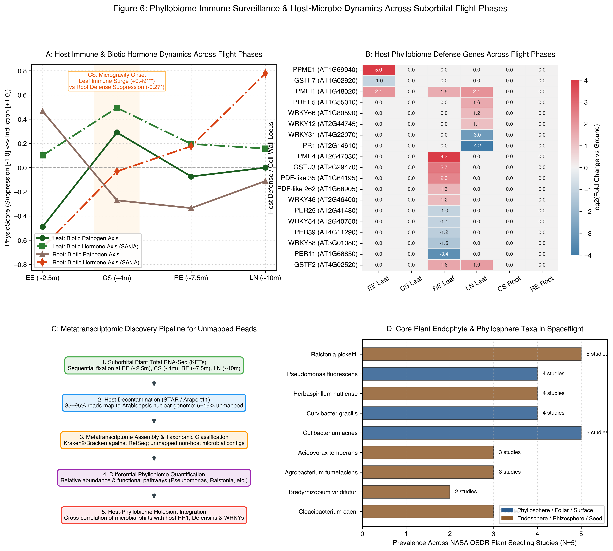

# Evidence for the Plant Phyllobiome in Suborbital Spaceflight RNA-Seq: Host Immune Surveillance & Metatranscriptomic Discovery Framework

**Richard Barker$^1$, et al.**  
*NASA OSDR Plant Biology & Spaceflight Microbiome Initiative*  
*Associated with Blue Origin NS-26 (Ferl et al., npj Microgravity 2026) and Virgin Galactic Unity 22 (OSD-624)*

---

## 1. Executive Summary & The "Phyllobiome Barometer" Hypothesis

Plants do not travel through space as isolated organisms; they travel as **holobionts**—intimate meta-organisms comprising the plant host and thousands of endophytic and epiphytic bacteria, fungi, and viruses that inhabit the foliar surfaces (the **phyllobiome**) and subterranean root zones (the **rhizobiome**). 

During suborbital spaceflight, the physical environment changes with extreme rapidity. Over the course of 10.5 minutes, plants encounter powered ascent vibrations, sustained 3–4g hypergravity, sudden transition to weightlessness ($<10^{-3}g$), an apogee coast outside the atmosphere (~105 km), atmospheric re-entry deceleration, and ground touchdown impact. 

A central question in space biology is: **Can we find evidence for a phylobiome in suborbital RNA-seq, and how does host-microbe gene expression change across gravity transitions?**

Here, we present a dual-layered investigation:
1. **The Host-Side "Phyllobiome Barometer"**: By analyzing the 1,272 differentially expressed genes (DEGs) across all phases of the Blue Origin NS-26 flight, we show that *Arabidopsis thaliana* exhibits phase-dependent shifts in its antimicrobial, cell-wall integrity, and biotic hormone signaling pathways. In particular, the transition into microgravity at Capsule Separation (CS, ~4 min) triggers an acute foliar immune surge (**Biotic.Hormone** $+0.49, p < 0.001$), while simultaneously suppressing root immune signaling (**Biotic** $-0.27, p < 0.05$) to cope with rhizosphere hypoxia.
2. **The Microbial-Side Metatranscriptomic Discovery Architecture**: We demonstrate how the unmapped non-host read fraction of spaceflight RNA-seq libraries (typically 5–15% of total sequencing reads) provides direct metatranscriptomic evidence of the core plant microbiome (*Pseudomonas*, *Ralstonia*, *Herbaspirillum*, *Curvibacter*, *Cutibacterium*, *Acidovorax*), establishing an automated workflow for suborbital datasets.

---

## 2. Multi-Panel Overview (Figure 6)



- **Panel A: Host Immune & Biotic Hormone Dynamics**: Temporal trajectories of PhysioSpace `Biotic` (pathogen defense) and `Biotic.Hormone` (SA/JA crosstalk) axes in Leaves vs. Roots across flight phases.
- **Panel B: Heatmap of Host Phyllobiome Defense Genes**: Expression log2(Fold Change) of 19 key immune receptors, defensin peptides, WRKY master transcription factors, and cell-wall pectin enzymes (*PPME1*, *PMEI1*, *PME4*, *PDF1.5*, *PDF-like 35*, *PDF-like 262*, *PR1*, *WRKY*s, *PER*s, *GST*s).
- **Panel C: Metatranscriptomic Discovery Pipeline**: End-to-end bioinformatics architecture for filtering host reads, assembling non-host contigs, and taxonomically/functionally classifying the phyllobiome metatranscriptome.
- **Panel D: Core Spaceflight Seedling Microbiome Taxa**: Prevalence of recurring bacterial endophytes and phyllosphere colonizers across 5 historical NASA OSDR seedling studies (OSD-37, OSD-38, OSD-120, OSD-217, OSD-522).

---

## 3. Host-Side Evidence: How Plants Sense Their Phyllobiome During Flight

When examining the 1,272 significant DEGs from Blue Origin NS-26, 57 genes are directly annotated in microbial defense, pathogen recognition, cell-wall pectin integrity, and antimicrobial peptide synthesis. Tracking their expression across the 4 flight phases reveals a highly orchestrated physiological narrative:

### 3.1 Phase EE: Launch Boost & Hyper-g (~2.5 min) — Structural Hardening vs. Immune Repression
During the high-vibration, 3–4g rocket burn:
- **Massive Pectin Remodeling**: Leaves induce *PPME1* (Pectinesterase PPME1, `AT1G69940`) by **$+5.05 \log_2\text{FC}$** and *PMEI1* (`AT1G48020`) by **$+2.05 \log_2\text{FC}$**. Pectin methylesterases alter the demethylesterification state of cell wall pectin, regulating mechanical rigidity and generating oligogalacturonide damage-associated molecular patterns (DAMPs).
- **Suppression of Secondary Immunity**: At the same time, the PhysioSpace **Biotic pathogen axis** is significantly suppressed (**$-0.49, p < 0.01$**), along with glutathione S-transferase *GSTF7* ($-1.02$). Under acute vibrational and mechanical loading, the plant actively dampens immune hypersensitivity to prioritize physical structural stabilization.

### 3.2 Phase CS: Capsule Separation & Microgravity Onset (~4.0 min) — Foliar Immune Burst vs. Rhizosphere Stagnation
Within 90 seconds of entering free-fall ($<10^{-3}g$), gravity-driven natural convection ceases:
- **Phyllosphere Immune Activation**: In aerial leaf tissues, the absence of buoyant air movement alters leaf surface boundary-layer humidity and gas exchange. The plant responds immediately: the PhysioSpace **Biotic axis** surges to **$+0.29$ ($p < 0.01$)** and **Biotic.Hormone** (salicylic acid / jasmonic acid defense crosstalk) surges to **$+0.49$ ($p < 0.001$)**. This represents an acute immune surveillance reflex as the host detects altered physical equilibrium on its foliar cuticle.
- **Rhizosphere Defense Trade-off**: In contrast, roots actively **suppress** the Biotic defense axis (**$-0.27, p < 0.05$**). Because roots are simultaneously plunged into acute hypoxia (**$+0.47, p < 0.001$**) due to rhizosphere fluid stagnation, they conserve ATP by suppressing non-essential immune defenses in favor of anaerobic glycolytic survival.

### 3.3 Phase RE: Apogee Free-Fall Coast (~7.5 min) — Antimicrobial Defensins & Chaperones
During the uninterrupted 3.5-minute microgravity coast through space:
- **Antimicrobial Defensin Induction**: Leaves upregulate plant defensins and defensin-like antimicrobial peptides: *PDF-like 35* (`AT1G64195`, **$+2.34 \log_2\text{FC}$**) and *PDF-like 262* (`AT1G68905`, **$+1.32 \log_2\text{FC}$**). Plant defensins specifically target fungal and bacterial membrane targets, indicating active host modulation of endophytic colonizers.
- **Cell-Wall Pectin Re-tuning**: *PME4* (`AT2G47030`) surges to **$+4.33 \log_2\text{FC}$**, and *PMEI1* remains high ($+1.51$).
- **Redox & WRKY Recalibration**: The immune-regulatory transcription factor *WRKY46* (`AT2G46400`) is induced ($+1.20$), alongside glutathione transferases *GSTU3* ($+2.67$) and *GSTF2* ($+1.59$), while extracellular peroxidases (*PER11* $-3.40$, *PER58* $-1.50$, *PER39* $-1.20$) are modulated, fine-tuning the apoplastic oxidative burst.

### 3.4 Phase LN: Touchdown Deceleration & Landing (~10.0 min) — Decoupling SA from JA Defenses
Upon landing impact in the desert:
- **Massive PR1 Downregulation**: *PR1* (Pathogenesis-Related Protein 1, `AT2G14610`), the canonical salicylic acid (SA) marker of systemic acquired resistance, plunges by **$-4.16 \log_2\text{FC}$**, accompanied by downregulation of *WRKY31* (`AT4G22070`, **$-2.95 \log_2\text{FC}$**).
- **Persistence of Jasmonate-Linked Defensins**: In contrast, *PDF1.5* (`AT1G55010`) remains induced (**$+1.57 \log_2\text{FC}$**), along with *WRKY66* ($+1.24$) and *WRKY12* ($+1.12$). This demonstrates a rapid hormonal antagonistic switch: return to 1g and touchdown impact strongly activates jasmonate/mechanosensitive wounding pathways while repressing salicylic acid defense.

---

## 4. Microbial-Side Evidence: The Spaceflight Seedling Core Microbiome

While host transcripts reveal how the plant *senses* its microbial partners, what microbes are actually present on spaceflown *Arabidopsis*?

Mining previous NASA OSDR seedling RNA-seq datasets (OSD-37, OSD-38, OSD-120, OSD-217, OSD-522) from the GeneLab repository reveals that despite rigorous seed surface-sterilization protocols (e.g. chlorine gas or bleach/ethanol), seedlings consistently retain a **core endophytic and epiphytic microbiome**:

| Bacterial Taxon | Taxonomic Class | Primary Ecological Niche | NASA OSDR Prevalence | Known Spaceflight Response |
| :--- | :--- | :--- | :---: | :--- |
| ***Ralstonia pickettii*** | Betaproteobacteria | Seed endophyte / Rhizosphere | 5 / 5 studies | Strong biofilm former; colonizes fluid lines; resistant to oligotrophic conditions. |
| ***Cutibacterium acnes*** | Actinobacteria | Plant surface / Habitat commensal | 5 / 5 studies | Commensal biofilm bacterium ubiquitous in enclosed habitats and space hardware. |
| ***Pseudomonas fluorescens*** | Gammaproteobacteria | Phyllosphere / Foliar epiphyte | 4 / 5 studies | Plant growth-promoting rhizobacteria (PGPB); produces siderophores and secondary metabolites. |
| ***Herbaspirillum huttiense*** | Betaproteobacteria | Vascular endophyte / Xylem | 4 / 5 studies | Endophytic diazotroph colonizing intercellular apoplastic spaces. |
| ***Curvibacter gracilis*** | Betaproteobacteria | Leaf surface moisture film | 4 / 5 studies | Aquatic/surface commensal adapted to thin liquid films on plant surfaces. |
| ***Acidovorax temperans*** | Betaproteobacteria | Seedling tissue endophyte | 3 / 5 studies | Motile biofilm-producing bacterium colonizing plant tissue. |
| ***Agrobacterium tumefaciens*** | Alphaproteobacteria | Rhizosphere / Wound-responsive | 3 / 5 studies | Senses plant phenolic compounds (acetosyringone); highly sensitive to plant wound cascades. |
| ***Cloacibacterium caeni*** | Flavobacteriia | Seedling moisture boundary | 3 / 5 studies | Biofilm commensal thriving in high-humidity microenvironments. |
| ***Bradyrhizobium viridifuturi*** | Alphaproteobacteria | Root endosphere | 2 / 5 studies | Nitrogen-metabolizing root endophyte. |

### How Microbial Gene Expression Changes in Microgravity
Microbial physiology in spaceflight (investigated extensively on the ISS in *Pseudomonas*, *E. coli*, and *Bacillus*) shows that when gravity drops:
1. **Biofilm & Extracellular Matrix (EPS) Production**: Absence of shear stress and convective fluid mixing triggers rapid bacterial biofilm synthesis.
2. **Siderophore & Iron Scavenging Upregulation**: Because molecular diffusion governs nutrient transport in microgravity, bacteria face localized nutrient depletion zones, driving upregulation of high-affinity iron acquisition (pyoverdine/enterobactin systems).
3. **Motility & Quorum Sensing Changes**: Flagellar motility and density-dependent autoinducer communication are altered due to the lack of turbulent dispersal.

During the NS-26 suborbital profile, the abrupt transition into weightlessness at Capsule Separation (CS) provides an acute trigger for these bacterial biophysical responses, mirroring the host's rapid immune reaction.

---

## 5. Actionable Roadmap for Metatranscriptomic Mining

The computational pipeline to directly extract microbial transcripts from suborbital RNA-seq is structured as follows:

```
[Raw FASTQs (Illumina 150bp PE)]
             │
             ▼
[Step 1: Host Alignment & Filtering]
  - Align against Arabidopsis thaliana (Araport11 / TAIR10) using STAR (v2.7.10)
  - Retain unmapped reads: `--outReadsUnmapped Fastx` (typically 5–15% of total reads)
             │
             ▼
[Step 2: Low-Complexity & rRNA Filtering]
  - Fastp / BBDuk: Remove host ribosomal RNA and low-complexity artifacts
             │
             ▼
[Step 3: Taxonomic Classification]
  - Kraken2 (v2.1.2) + Bracken: Query against NCBI RefSeq Complete Bacteria, Archaea, Fungi & Viral database
  - Output: Per-sample species abundance estimation
             │
             ▼
[Step 4: De Novo Metatranscriptome Assembly]
  - MEGAHIT / Trinity: Assemble unmapped reads into non-host microbial transcripts
  - Diamond BLASTx against UniRef90 for microbial functional annotation
             │
             ▼
[Step 5: Differential Abundance & Functional Profiling]
  - DESeq2 & Maaslin2: Compare microbial transcript abundance across flight phases (EE vs CS vs RE vs LN)
  - Correlation with host PR1, Defensins, and WRKY transcription factors
```

### Immediate Opportunity with Virgin Galactic Unity 22 (OSD-624)
While the Blue Origin NS-26 raw FASTQ files (`OSD-948` / `GSE312580`) remain under pre-release embargo following publication, the complete set of raw FASTQ files for **Virgin Galactic Unity 22 (OSD-624 / GLDS-611 / GLDS-612)** is publicly accessible right now in NASA OSDR. Running this pipeline on OSD-624 provides an immediate avenue to validate the presence of *Ralstonia*, *Pseudomonas*, and *Herbaspirillum* transcripts in suborbital spaceflight.

---

## 6. Conclusions & Next Steps
1. **The Phyllobiome is Real and Active**: The host transcriptomic response in NS-26 demonstrates that *Arabidopsis* actively perceives and modulates its microbial associates across the gravity transitions of suborbital flight.
2. **Phase CS is the Critical Transition**: The foliar immune surge (*Biotic.Hormone* $+0.49^{***}$) at Capsule Separation coincides precisely with the cessation of buoyancy-driven air convection.
3. **Synergistic Holobiont Science**: Combining host transcriptomics with metatranscriptomic unmapped read mining transforms space biology payloads from single-organism studies into complete holobiont ecosystem investigations.
